<div align="center">

# AI Literacy Digital Twin

### A case-based AI literacy platform with personal and campus digital twins

**SDÜ Yapay Zeka Okuryazarlığı: Kampüs İkizi Platformu**<br>
Developed for the AI Application and Research Center (YAZEM), Süleyman Demirel University, Isparta, Türkiye

[](#acknowledgements)
[](LICENSE)
[](#overview)
<br>
[](https://www.python.org)
[](https://fastapi.tiangolo.com)
[](https://www.postgresql.org)
[](https://react.dev)

**First version: October 2026. Last update: October 2026.**

**Prof. Dr. Utku Köse**<br>
Department of Computer Engineering, Süleyman Demirel University, Isparta, Türkiye<br>
Founding Director, AI Application and Research Center (YAZEM), Süleyman Demirel University<br>
University of North Dakota, Grand Forks, USA · Universidad Panamericana, Mexico City, Mexico · Vel Tech University, Chennai, India<br>
IEEE Senior Member · ACM Professional Member

[](https://orcid.org/0000-0002-9652-6415)
[](https://www.utkukose.com)
[](https://github.com/utkukose)

**Enes Şenol**<br>
Research Developer · Undergraduate Student, Süleyman Demirel University, Isparta, Türkiye

[](https://www.linkedin.com/in/enes-senol-aa652b242/)

**[English](#english) · [Türkçe](#turkce)**

</div>

---

<a id="english"></a>

# English

<p align="center">
<br>
<sub>The My twin screen. Each petal of the rose is one of the seven areas of AI literacy, and its pale halo shows how certain the twin is of the estimate.</sub>
</p>

## Overview

AI Literacy Digital Twin is a web platform that measures and develops the AI literacy of a university campus through realistic cases. It was developed for the AI Application and Research Center (YAZEM) of Süleyman Demirel University (SDÜ) in Isparta, Türkiye, and it addresses students, academic staff and administrative staff alike. The interface is available in Turkish and in English.

Users solve cases drawn from everyday and working life on campus, such as checking a reference list written by a chat model, deciding what may be shared with an AI tool or recognising a cloned voice. Every answer updates the user's digital twin, a model that estimates the user's competence in seven areas of AI literacy together with the uncertainty of each estimate. Before each step, the twin predicts the chance of a correct answer and seals this prediction with a cryptographic hash, so that anyone can verify afterwards that the prediction was made before the answer. The twin then chooses the next case from what it has learned. The users' twins together form a campus twin, which shows on a live campus map where the campus stands in each area without exposing any individual.

No generative AI runs inside the platform. Every outcome, score and recommendation is computed by explicit rules and formulas that can be traced step by step. This keeps every result explainable, which also matters for the right to object to decisions based solely on automated processing under Article 11 of the Turkish Personal Data Protection Law (KVKK).

## Screenshots

The screenshots were taken from the platform's demonstration mode, which runs on a separate database filled with synthetic users.

| | |
|---|---|
| 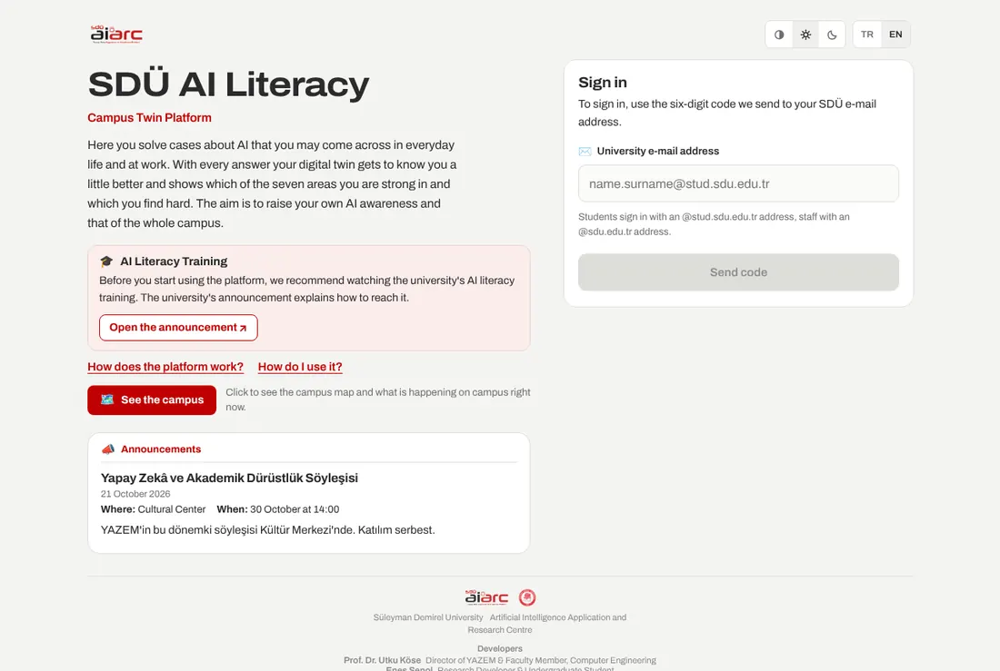<br><sub>Signing in with a six-digit code sent to the university e-mail address. There is no password.</sub> | 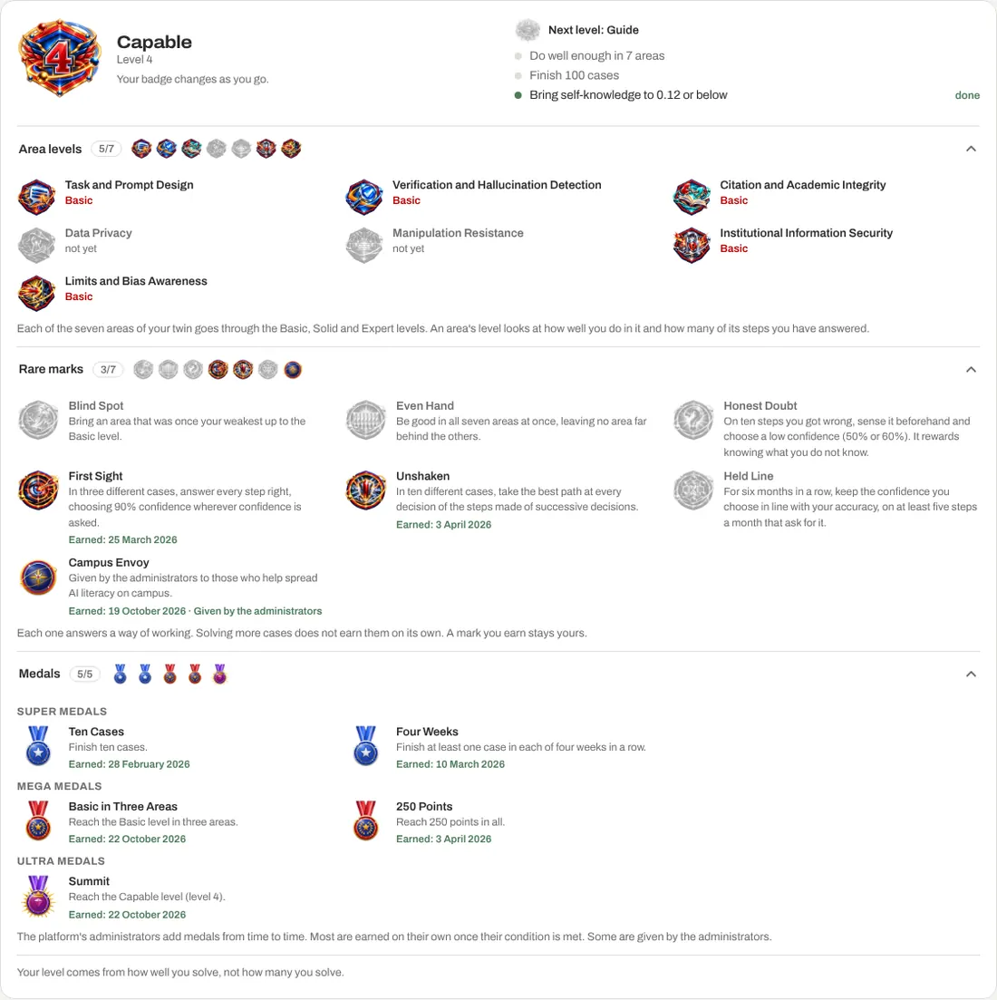<br><sub>The badge: the level, the seven area levels, the rare marks and the medals.</sub> |
| 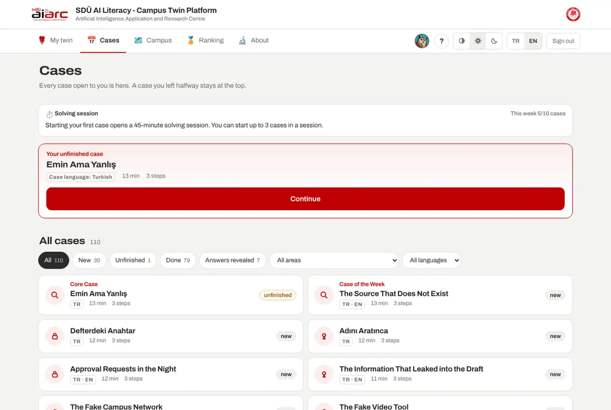<br><sub>The case list opens with the case the twin recommends and the reason for it.</sub> | 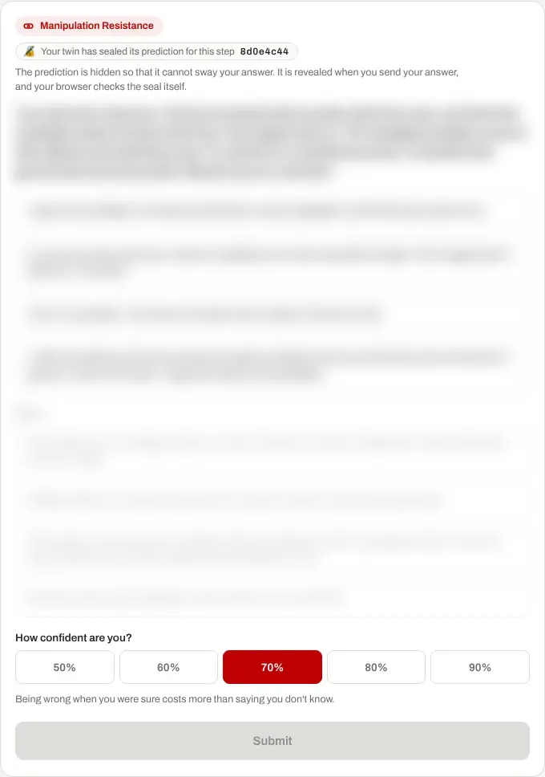<br><sub>A step: the twin's sealed prediction, then the answer and a confidence between 50% and 90%. The case text is blurred here.</sub> |
| 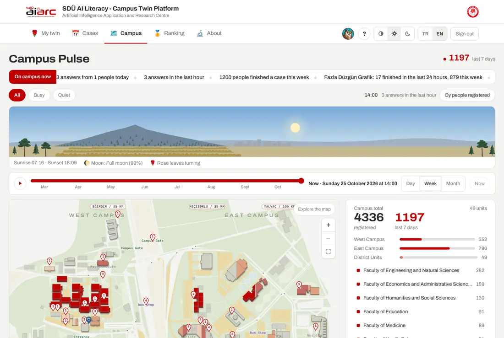<br><sub>The campus map under the real sky of Isparta, with participation and the campus twin.</sub> | 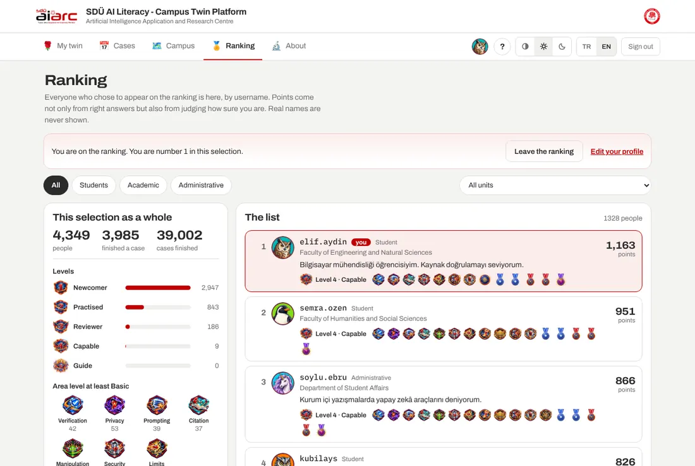<br><sub>The optional ranking lists only those who chose to join, by username, and can be narrowed by role and unit.</sub> |
| 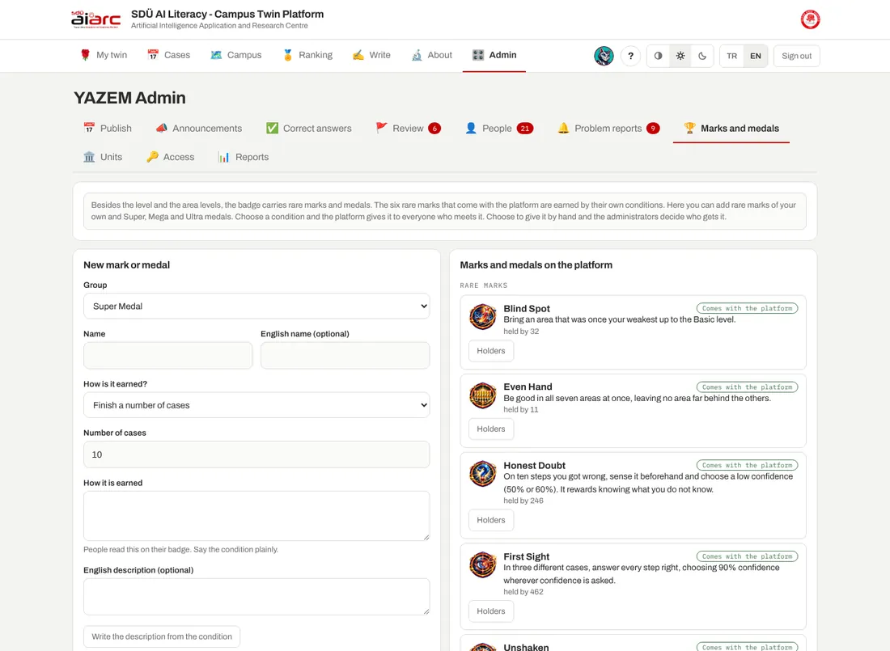<br><sub>The administration panel, here adding rare marks and medals with conditions.</sub> | 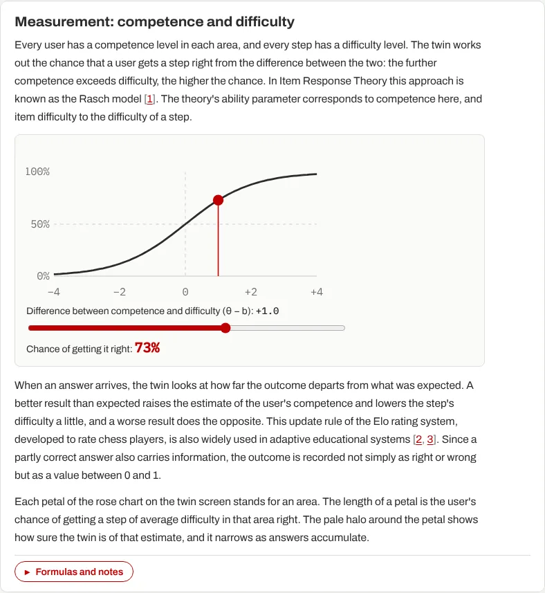<br><sub>The About page explains the measurement with its formulas and references.</sub> |

## The seven areas and the cases

AI literacy is not a single skill but a combination of different competencies [12, 13]. The platform measures it in seven areas.

| Area | What it covers |
|---|---|
| Task and Prompt Design | Describing the task, the context and the expected output clearly. |
| Verification and Hallucination Detection | Noticing invented facts and sources, and testing a claim against other sources. |
| Citation and Academic Integrity | Citing sources, declaring the use of AI and protecting authorship. |
| Data Privacy | Stopping to think before sharing personal or sensitive data with an AI tool. |
| Manipulation Resistance | Recognising fake voices and images, and content built to persuade. |
| Institutional Information Security | Using institutional accounts and third-party tools properly, and reporting a security incident. |
| Limits and Bias Awareness | Knowing about bias, the limits of models and the situations where AI should not be used. |

The case bank holds more than 150 cases written in Turkish, 70 of which are also available in English. Each case describes a realistic situation on campus and usually has three steps. A step may ask the user to mark problematic phrases in a text, to decide whether references are real, to rewrite a text so that it follows given rules, to make a reasoned choice or to take a series of decisions. Cases come in several variants in which names and numbers change while the right decision stays the same, and the variant a user sees is set by a number derived from the user's pseudonym. A result and a short explanation follow each step, a solution note closes the case, and the correct answers are revealed to everyone who finished a case once enough people have finished it. The answer key of every step stays on the server, and no part of it reaches the browser before the step is answered.

## The digital twin

A digital twin is a model of a real entity that is updated continuously with the data the entity produces [9]. The twin on this platform models a user's AI literacy. It works in a loop: it predicts and seals, the user answers, it compares and updates, and it chooses what comes next.

Every user has a competence level θ in each area, and every step has a difficulty b. The twin computes the chance of a correct answer from the difference between the two, as the Rasch model of Item Response Theory does [1]:

$$P = \frac{1}{1 + e^{-(\theta - b)}}$$

When an answer arrives, the twin compares the outcome x, a value between 0 and 1 that also credits partly correct answers, with the sealed prediction P. It updates both estimates with the rule of the Elo rating system, which is also widely used in adaptive educational systems [2, 3]:

$$\theta \leftarrow \theta + K\,(x - P), \qquad b \leftarrow b - K_b\,(x - P)$$

The learning rate K is 0.40 for a user's first ten answers in an area and 0.15 afterwards, so the twin learns fast while it knows the user little and carefully once it knows more. The rate for difficulty, K_b = 0.05 · 30 / (30 + n), slows down as a step is answered n times, and difficulty is kept separately for each variant. The uncertainty of an estimate is the standard error of the Rasch model, SE = 1 / √(1 + Σ p(1 − p)). The rose chart shows θ ± 1.28 SE as a pale halo around each petal, a range that contains the true competence four times out of five.

## Confidence, scoring and calibration

In every step except branching decisions, users also state how sure they are of their answer: 50%, 60%, 70%, 80% or 90%. The scale stops short of 100% on purpose, because what is measured is how accurately users weigh their own knowledge. Points follow a proper scoring rule, under which the expected score is highest when users state the confidence they actually hold [4, 6]:

$$\text{points} = v \cdot \left(1 - 4\,(c - s)^2\right)$$

Here v is the value of the step, c is the stated confidence, and s is 1 when the outcome reaches the success threshold of 0.8 and 0 otherwise. An answer given with 50% confidence neither earns nor loses points, while being very sure and wrong costs more than the step is worth. Repeating someone else's answer therefore does not pay.

Calibration is measured with the Brier score, (c − s)², averaged over the last 30 steps [4]. The twin screen sets the user's Brier score beside the twin's own and splits it with Murphy's decomposition into reliability, resolution and uncertainty [5]. The area under the ROC curve (AUROC) shows how well the stated confidence separates right answers from wrong ones, an established measure of metacognitive sensitivity [7]. Points are kept apart from the level and the badge, which depend only on the competence the twin measures.

## Sealed predictions

As each step appears, the twin computes the chance of a correct answer and seals it as SHA-256(attempt : step : P : salt), where P is written to four decimals and the salt is a random string of 32 characters. Before answering, the user sees only the seal. Once the answer is sent, the prediction and the salt are revealed, and the browser computes the seal again and compares the two values. This commitment scheme gives a guarantee similar to preregistration in research, where a hypothesis is recorded before the data are collected [11]. The twin updates itself only from the sealed value.

## Choosing the next case

The twin first checks whether an area is due for review. An area answered below the success threshold returns the next day, and successful reviews stretch the interval to three, seven and twenty-one days, following one of the most robust findings of learning research [8]. When no area is due, the area set by the administration is chosen, and failing that, the area the twin knows least about. Within the chosen area, the case whose chance of success is closest to 65% is recommended, and the case card says why it was chosen.

## Hints and the built-in experiment

When the sealed prediction for a step is below 45%, a strategy hint suited to the kind of step is shown before it. The hint does not give the answer. Whether hints help is tested in a built-in randomised experiment: users are assigned to a hint group and a comparison group by their pseudonym, the mean of x − P is computed per user, and the difference between the groups is reported with a 95% confidence interval once each group has at least 20 users. A user whose confidence in an area has stayed clearly above their accuracy also sees a short warning when choosing a high confidence.

## The badge

The badge shows a user's progress in four parts. The level (Newcomer, Practised, Reviewer, Capable and Guide) and the area levels (Basic, Solid and Expert in each of the seven areas) are read from the twin's current estimates, so they follow competence rather than the number of cases solved. A level requires, all at once, a minimum chance of success on a step of average difficulty in enough areas, a number of finished cases and, from the third level on, a good enough calibration. Rare marks reward a way of working, for example sensing ten wrong answers in advance with a low confidence, and medals in the Super, Mega and Ultra groups are added by the administration with conditions or granted by hand. Marks and medals are checked whenever a case is finished and, once earned, are kept. The only exception is an attempt that the administration sets aside for breaking the rules, which takes back only what that attempt earned.

## The campus twin and privacy

The campus map shows participation on campus, the campus twin's standing in the seven areas and each unit's position against the campus average. A figure broken down by unit, area or day is published only when it rests on at least ten people, following the principle of k-anonymity [10]. Units never receive numeric scores or a ranking: a unit appears in only one of three bands, above, level with or below the campus, and the band changes only when the gap exceeds 0.35 on the competence scale. The time and the unit of a single answer appear on no screen.

The sky above the map is Isparta's real sky, with the actual positions of the sun and the moon and the current weather, while the snow on Mount Davraz, the pines and the rose gardens follow the season. The map also marks where cases are set and where events take place, shows the step the campus has found hardest lately among cases whose answers have been revealed, and offers a time bar for going back to earlier days. Every day the campus twin forecasts the number of answers the campus will give, from the mean of the last seven days and the mean of the same weekday over the last four weeks. The forecast is sealed in the same way as the personal predictions and is revealed and checked against the actual count when the day is over. The administration can open the campus page to visitors who have not signed in.

## Signing in and personal data

The platform has no passwords. Users sign in with a six-digit code, valid for fifteen minutes, which is sent to their university e-mail address (@stud.sdu.edu.tr for students and @sdu.edu.tr for staff), and personal e-mail addresses are refused. E-mail addresses are stored encrypted in the database, and what users write about themselves is approved by the administration before others can see it. The fonts are served by the platform itself, so opening a page sends no request to third parties. Every result can be explained step by step, as described above.

## Administration and case authoring

The administration panel covers publishing, announcements, the rule for revealing correct answers, a review list, people and profile approvals, problem reports from users, marks and medals, the university's units, access rights and participation reports. Solving limits per session and per week can be set from the panel, and an attempt that breaks the rules can be set aside. Editors write cases in a dedicated editor, which checks a case against the case schema, solves every variant with the best and the worst answers and keeps every published version. The platform also has a demonstration mode with synthetic users on a separate database, protected by its own password.

## Architecture

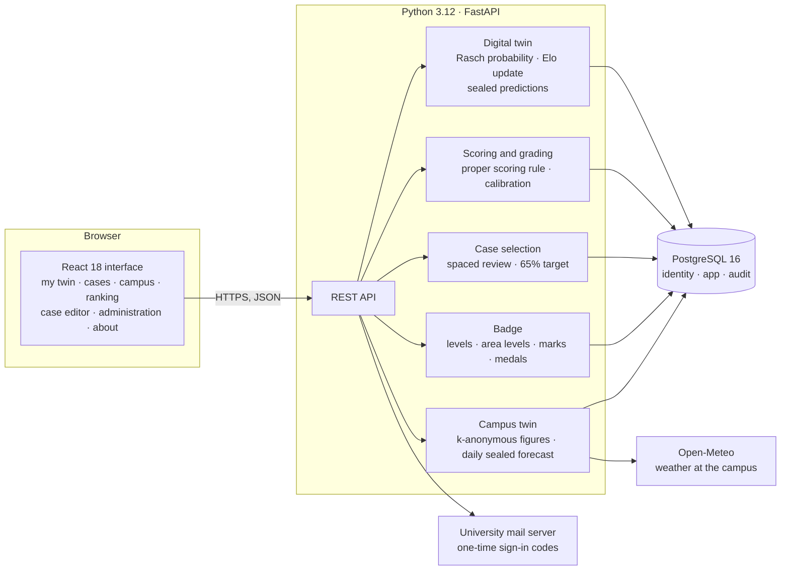

The server is a FastAPI application in Python 3.12 that uses psycopg 3 to talk to PostgreSQL 16. The database keeps identities, the platform's data and the audit trail in separate schemas. The interface is a React 18 application built with esbuild into a single bundle. The platform runs in containers, and an automated test suite of more than 3,000 checks, including end-to-end tests in a real browser, accompanies every change.

## About this repository

This repository publishes the platform's source code for visibility and as a record of its authorship. It contains the server (`server/`), the interface (`ui/`), the interface translations (`i18n/`) and the build script (`build.mjs`). It does not contain the case bank, the database schema and its migrations, the deployment configuration, the operational documentation, the test suite, the internal tools, the generator of synthetic users or the visual assets. The platform therefore cannot be run from this repository, and running it in any form requires written permission (see [License](#license)).

## How the platform was developed

The platform was developed through human-AI collaboration. Human intellectual knowledge and expertise are its fundamental starting point. The developers set its educational design, the seven-area framework, the measurement model and every decision about privacy, and they guided and supervised every stage of the work. Code, case texts and images were produced with the help of AI tools under the developers' direction and were reviewed and tested by them. The images of the platform, such as the badge emblems, the avatars and the case illustrations, were made with generative image models, and some of them were drawn in code. The final version is presented only after the developers' review and approval. The platform itself contains no generative AI.

## License

This repository is source-available. It is not open source. The code may be viewed, read and cited, but installing, running, hosting, copying, modifying or distributing the platform, using its content elsewhere or using it to train AI models requires the prior written permission of the copyright holders. The full terms are in [LICENSE](LICENSE), in English and in Turkish. Requests can be sent to Prof. Dr. Utku Köse (utkukose@sdu.edu.tr).

Copyright © 2026 Utku Köse and Enes Şenol. All rights reserved.

## Citation

If you refer to the platform, please cite it as follows. A machine-readable citation is in `CITATION.cff`, and this section will be updated when a paper on the platform is published.

```bibtex
@software{kose_senol_2026_ai_literacy_digital_twin,
  author    = {K{\"o}se, Utku and {\c{S}}enol, Enes},
  title     = {{AI Literacy Digital Twin: A Case-Based AI Literacy Platform with Personal and Campus Digital Twins}},
  year      = {2026},
  month     = oct,
  version   = {1.0.0},
  publisher = {GitHub},
  url       = {https://github.com/utkukose/AI-Literacy-Digital-Twin}
}
```

## References

[1] Rasch, G. (1960). *Probabilistic models for some intelligence and attainment tests*. Danish Institute for Educational Research.

[2] Elo, A. E. (1978). *The rating of chessplayers, past and present*. Arco Publishing.

[3] Pelánek, R. (2016). Applications of the Elo rating system in adaptive educational systems. *Computers & Education*, *98*, 169–179. https://doi.org/10.1016/j.compedu.2016.03.017

[4] Brier, G. W. (1950). Verification of forecasts expressed in terms of probability. *Monthly Weather Review*, *78*(1), 1–3. https://doi.org/10.1175/1520-0493(1950)078<0001:VOFEIT>2.0.CO;2

[5] Murphy, A. H. (1973). A new vector partition of the probability score. *Journal of Applied Meteorology*, *12*(4), 595–600. https://doi.org/10.1175/1520-0450(1973)012<0595:ANVPOT>2.0.CO;2

[6] Gneiting, T., & Raftery, A. E. (2007). Strictly proper scoring rules, prediction, and estimation. *Journal of the American Statistical Association*, *102*(477), 359–378. https://doi.org/10.1198/016214506000001437

[7] Fleming, S. M., & Lau, H. C. (2014). How to measure metacognition. *Frontiers in Human Neuroscience*, *8*, Article 443. https://doi.org/10.3389/fnhum.2014.00443

[8] Cepeda, N. J., Pashler, H., Vul, E., Wixted, J. T., & Rohrer, D. (2006). Distributed practice in verbal recall tasks: A review and quantitative synthesis. *Psychological Bulletin*, *132*(3), 354–380. https://doi.org/10.1037/0033-2909.132.3.354

[9] Grieves, M., & Vickers, J. (2017). Digital twin: Mitigating unpredictable, undesirable emergent behavior in complex systems. In F.-J. Kahlen, S. Flumerfelt, & A. Alves (Eds.), *Transdisciplinary perspectives on complex systems: New findings and approaches* (pp. 85–113). Springer International Publishing. https://doi.org/10.1007/978-3-319-38756-7_4

[10] Sweeney, L. (2002). k-anonymity: A model for protecting privacy. *International Journal of Uncertainty, Fuzziness and Knowledge-Based Systems*, *10*(5), 557–570. https://doi.org/10.1142/S0218488502001648

[11] Nosek, B. A., Ebersole, C. R., DeHaven, A. C., & Mellor, D. T. (2018). The preregistration revolution. *Proceedings of the National Academy of Sciences*, *115*(11), 2600–2606. https://doi.org/10.1073/pnas.1708274114

[12] Long, D., & Magerko, B. (2020). What is AI literacy? Competencies and design considerations. In *Proceedings of the 2020 CHI Conference on Human Factors in Computing Systems* (pp. 1–16). Association for Computing Machinery. https://doi.org/10.1145/3313831.3376727

[13] Köse, U. (2026). *Yapay Zekâ Okuryazarlığı Eğitimi*. SDÜ Süleyman Demirel Üniversitesi Uzaktan Eğitim Uygulama ve Araştırma Merkezi. https://uzem.sdu.edu.tr/tr/haber/yapay-zek-okuryazarligi-egitimi-erisime-acildi-62530h.html

## Acknowledgements

The platform was developed for the AI Application and Research Center (YAZEM) of Süleyman Demirel University. The developers thank Süleyman Demirel University for its support of YAZEM's work on AI literacy on campus.

---

<a id="turkce"></a>

# Türkçe

<p align="center">
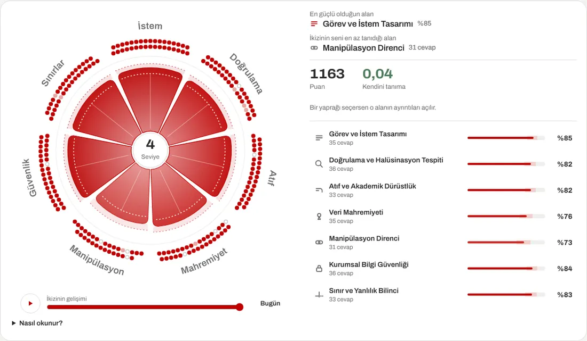<br>
<sub>İkizim ekranı. Gülün her yaprağı yapay zekâ okuryazarlığının yedi alanından birini gösterir, yaprağın çevresindeki açık renkli hâle ise ikizin bu tahminden ne kadar emin olduğunu belirtir.</sub>
</p>

## Genel bakış

AI Literacy Digital Twin, bir üniversite kampüsünün yapay zekâ okuryazarlığını gerçekçi vakalar üzerinden ölçen ve geliştiren bir web platformudur. Platform, Isparta'daki Süleyman Demirel Üniversitesi (SDÜ) Yapay Zekâ Uygulama ve Araştırma Merkezi (YAZEM) için geliştirilmiştir ve öğrencilere, akademik personele ve idari personele birlikte seslenmektedir. Arayüz Türkçe ve İngilizce olarak kullanılabilir.

Kullanıcılar kampüsteki gündelik hayattan ve çalışma hayatından alınmış vakaları çözer. Bir sohbet modelinin yazdığı kaynakçayı denetlemek, bir yapay zekâ aracıyla neyin paylaşılabileceğine karar vermek ya da taklit edilmiş bir sesi tanımak bu vakalara örnektir. Her cevap kullanıcının dijital ikizini günceller. Dijital ikiz, kullanıcının yapay zekâ okuryazarlığının yedi alanındaki yetkinliğini ve bu tahminlerin her birinin belirsizliğini izleyen bir modeldir. İkiz her adımdan önce kullanıcının o adımı doğru çözme olasılığını tahmin eder ve bu tahmini kriptografik bir özetle mühürler. Böylece tahminin cevaptan önce yapıldığını herkes sonradan doğrulayabilir. İkiz ardından öğrendiklerine göre sıradaki vakayı seçer. Kullanıcıların ikizleri bir araya gelerek kampüs ikizini oluşturur. Kampüs ikizi, canlı bir kampüs haritasında kampüsün her alanda nerede durduğunu kimseyi tek başına görünür kılmadan göstermektedir.

Platformun içinde üretken yapay zekâ çalışmaz. Her sonuç, puan ve öneri adım adım izlenebilen açık kurallar ve formüllerle hesaplanır. Bu sayede her sonuç açıklanabilir. Bu durum, 6698 sayılı Kişisel Verilerin Korunması Kanunu'nun (KVKK) 11. maddesinde tanınan, yalnızca otomatik sistemlerle yapılan analiz sonucunda ortaya çıkan aleyhe bir sonuca itiraz etme hakkı açısından da önem taşımaktadır.

## Ekran görüntüleri

Ekran görüntüleri, platformun sentetik kullanıcılarla dolu ayrı bir veritabanında çalışan demo kipinden alınmıştır.

| | |
|---|---|
| 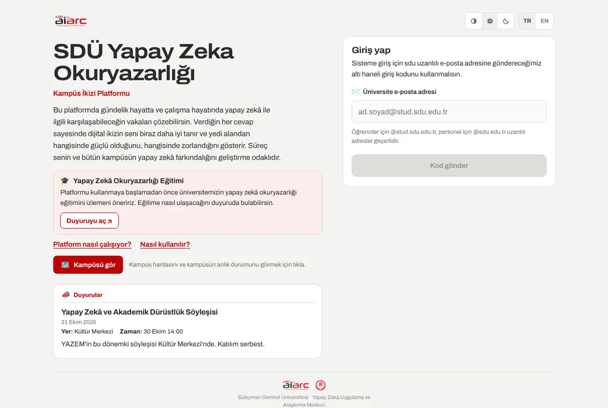<br><sub>Üniversite e-posta adresine gönderilen altı haneli kodla giriş. Parola yoktur.</sub> | 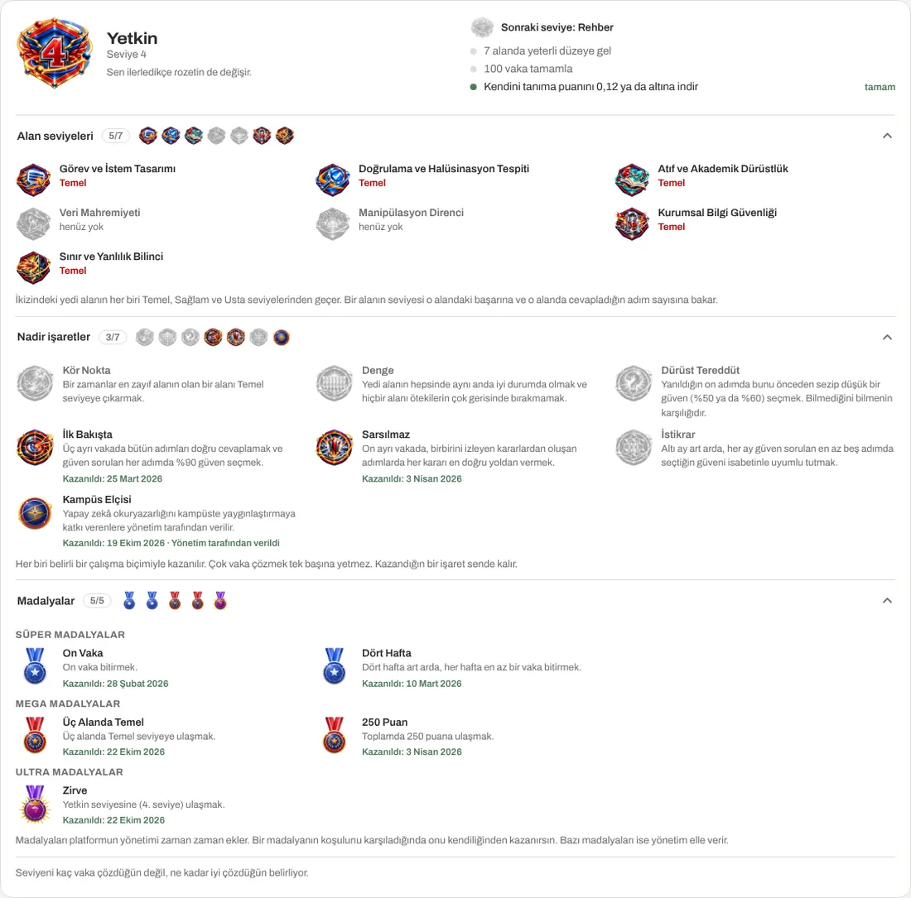<br><sub>Rozet: Seviye, yedi alanın seviyeleri, nadir işaretler ve madalyalar.</sub> |
| 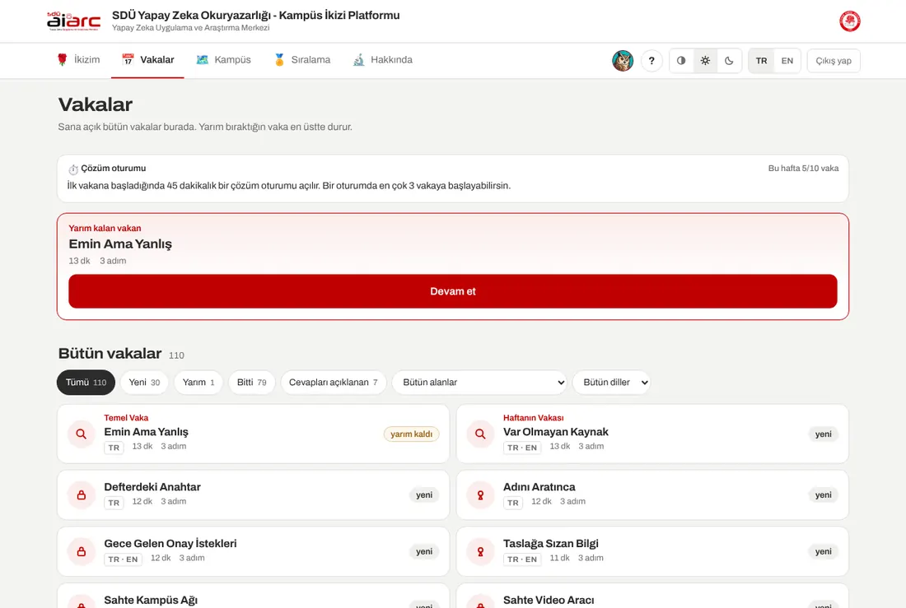<br><sub>Vaka listesi, ikizin önerdiği vaka ve önerinin gerekçesiyle açılır.</sub> | 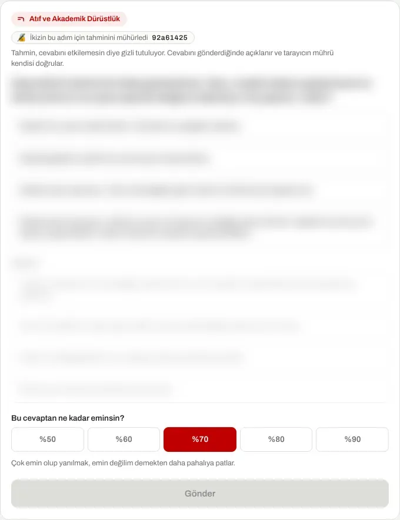<br><sub>Bir adım: İkizin mühürlü tahmini, ardından cevap ve %50 ile %90 arasında bir güven düzeyi. Vaka metni burada bulanıklaştırılmıştır.</sub> |
| 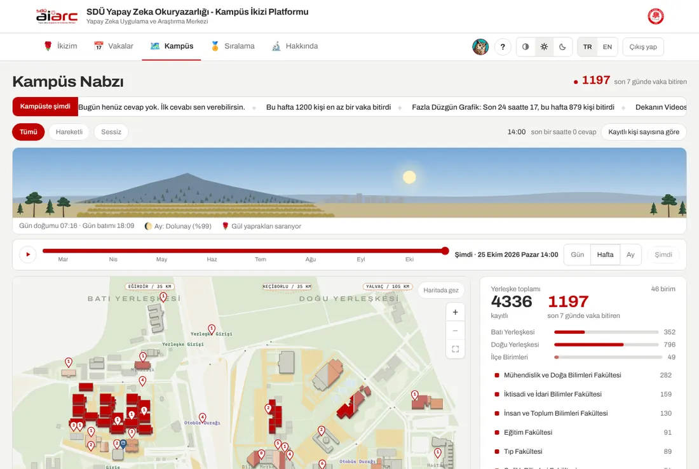<br><sub>Isparta'nın gerçek gökyüzü altında katılımı ve kampüs ikizini gösteren kampüs haritası.</sub> | 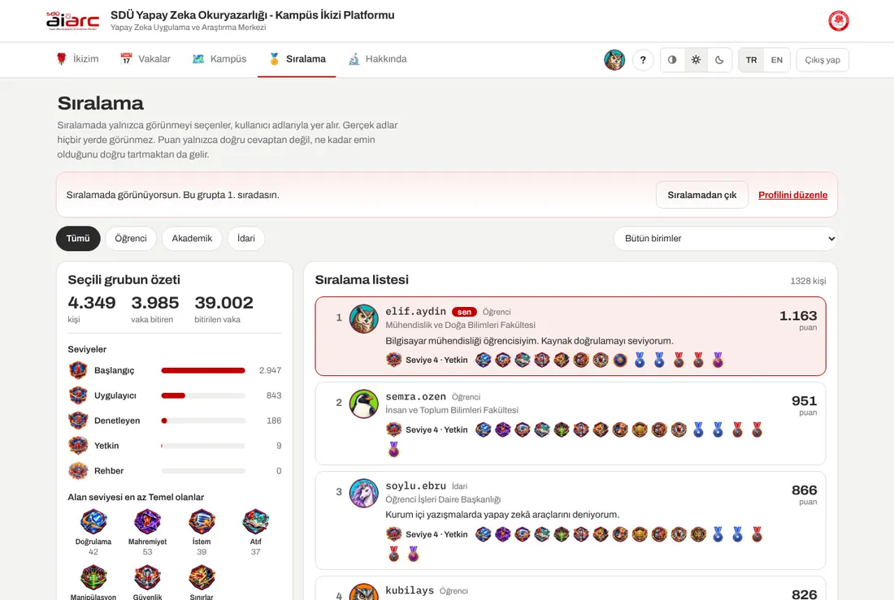<br><sub>İsteğe bağlı sıralamada yalnızca katılmayı seçenler kullanıcı adlarıyla yer alır. Liste rol ve birime göre daraltılabilir.</sub> |
| 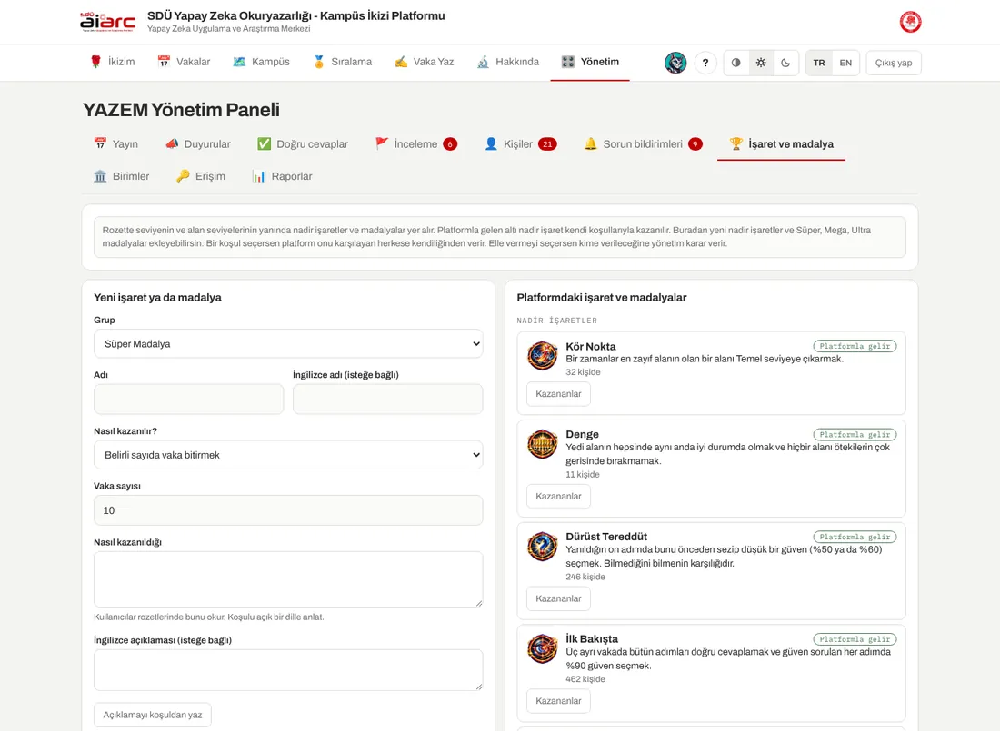<br><sub>Yönetim paneli. Burada koşullu nadir işaretler ve madalyalar ekleniyor.</sub> | 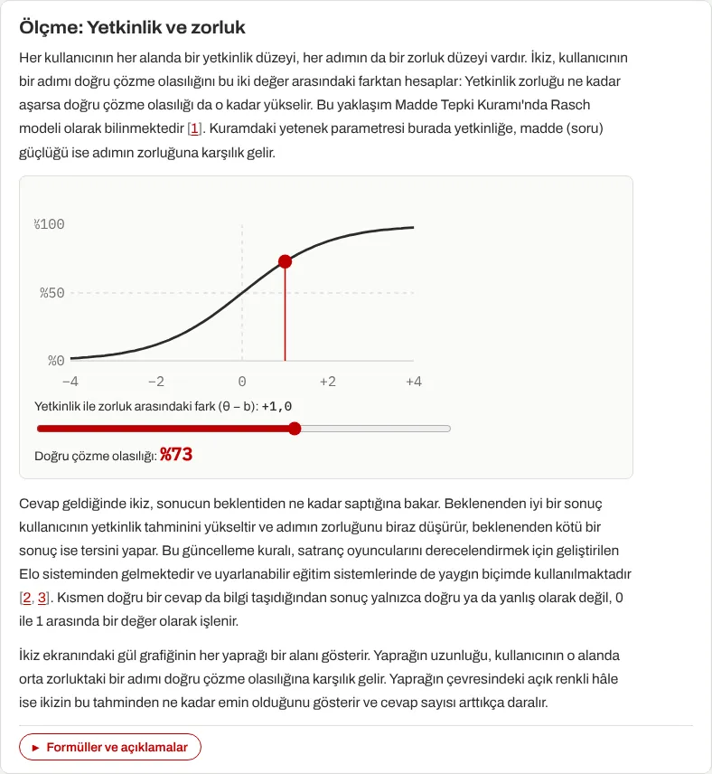<br><sub>Hakkında sayfası ölçmeyi formülleri ve kaynaklarıyla anlatır.</sub> |

## Yedi alan ve vakalar

Yapay zekâ okuryazarlığı tek bir beceriden ibaret değildir, birbirinden farklı yetkinlikleri bir arada içerir [12, 13]. Platform bu yetkinlikleri yedi alanda ölçmektedir.

| Alan | Kapsamı |
|---|---|
| Görev ve İstem Tasarımı | Görevi, bağlamı ve beklenen çıktıyı açık biçimde tarif etmek. |
| Doğrulama ve Halüsinasyon Tespiti | Uydurma bilgiyi ve uydurma kaynağı fark etmek, bir iddiayı başka kaynaklarla sınamak. |
| Atıf ve Akademik Dürüstlük | Kaynak göstermek, yapay zekâ kullanımını beyan etmek ve yazarlığı korumak. |
| Veri Mahremiyeti | Kişisel ya da hassas bir veriyi bir yapay zekâ aracıyla paylaşmadan önce durup düşünmek. |
| Manipülasyon Direnci | Sahte ses ve görüntüleri, ikna amacıyla kurgulanmış içerikleri tanımak. |
| Kurumsal Bilgi Güvenliği | Kurum hesaplarını ve üçüncü taraf araçları doğru kullanmak, bir güvenlik olayını bildirmek. |
| Sınır ve Yanlılık Bilinci | Yanlılığı fark etmek, modellerin sınırlarını ve yapay zekânın kullanılmaması gereken durumları bilmek. |

Vaka bankasında Türkçe yazılmış 150'den fazla vaka bulunmaktadır ve bunların 70'i İngilizce olarak da sunulmaktadır. Her vaka kampüste yaşanabilecek gerçekçi bir durumu anlatır ve genellikle üç adımdan oluşur. Adımlarda bir metindeki sorunlu ifadeleri işaretlemek, künyelerin gerçek olup olmadığına karar vermek, bir metni belirli kurallara uyacak biçimde yeniden yazmak, gerekçeli bir seçim yapmak ya da birbirini izleyen kararlar vermek gerekir. Vakaların birden fazla çeşidi vardır. Çeşitler arasında adlar ve sayılar değişir, doğru karar ise aynı kalır. Kullanıcının hangi çeşidi göreceği, takma kimliğinden türetilen bir sayıyla belirlenir. Her adımın ardından bir sonuç ve kısa bir açıklama gelir, vaka bir çözüm notuyla kapanır. Bir vakanın doğru cevapları, vakayı yeterli sayıda kişi bitirdiğinde vakayı bitiren herkese açıklanır. Her adımın cevap anahtarı sunucuda kalır ve adım cevaplanmadan önce hiçbir parçası tarayıcıya gönderilmez.

## Dijital ikiz

Dijital ikiz, gerçek bir varlığın modelidir ve o varlıktan gelen verilerle sürekli güncellenir [9]. Bu platformdaki ikiz, kullanıcının yapay zekâ okuryazarlığını modellemektedir. İkiz bir döngü içinde çalışır: Tahmin eder ve mühürler, kullanıcı cevap verir, ikiz karşılaştırır ve kendini günceller, ardından sıradakini seçer.

Her kullanıcının her alanda bir yetkinlik düzeyi (θ), her adımın da bir zorluk düzeyi (b) vardır. İkiz, doğru cevap olasılığını Madde Tepki Kuramı'ndaki Rasch modelinde olduğu gibi bu iki değer arasındaki farktan hesaplar [1]:

$$P = \frac{1}{1 + e^{-(\theta - b)}}$$

Cevap geldiğinde ikiz, kısmen doğru cevapları da hesaba katan ve 0 ile 1 arasında değer alan sonucu (x) mühürlediği tahminle (P) karşılaştırır. Ardından iki tahmini de uyarlanabilir eğitim sistemlerinde yaygın biçimde kullanılan Elo derecelendirme sisteminin kuralıyla günceller [2, 3]:

$$\theta \leftarrow \theta + K\,(x - P), \qquad b \leftarrow b - K_b\,(x - P)$$

Öğrenme katsayısı K, kullanıcının bir alandaki ilk on cevabında 0,40, sonrasında 0,15'tir. Böylece ikiz kullanıcıyı az tanırken hızlı, tanıdıkça daha temkinli öğrenir. Zorluk için kullanılan K_b = 0,05 · 30 / (30 + n) katsayısı, adım n kez cevaplandıkça küçülür ve zorluk vakanın her çeşidi için ayrı tutulur. Bir tahminin belirsizliği, Rasch modelinin standart hatasıyla, SH = 1 / √(1 + Σ p(1 − p)) olarak hesaplanır. Gül grafiği her yaprağın çevresinde θ ± 1,28 SH aralığını açık renkli bir hâle olarak gösterir. Bu aralık gerçek yetkinliği beş durumdan dördünde kapsamaktadır.

## Güven, puan ve kalibrasyon

Birbirini izleyen kararlardan oluşan adımlar dışındaki her adımda kullanıcı, cevabından ne kadar emin olduğunu da belirtir: %50, %60, %70, %80 ya da %90. Ölçeğin %90'da bitmesi bilinçli bir tercihtir, çünkü ölçülmek istenen kullanıcının kendi bilgisini ne kadar doğru tarttığıdır. Puan, uygun puanlama kuralı olarak bilinen ve beklenen puanı kullanıcı gerçekte duyduğu güveni belirttiğinde en yüksek yapan bir kurala göre hesaplanır [4, 6]:

$$\text{puan} = v \cdot \left(1 - 4\,(c - s)^2\right)$$

Burada v adımın değeri, c belirtilen güvendir. s ise sonuç 0,8 olan başarı eşiğine ulaştığında 1, ulaşmadığında 0 değerini alır. %50 güvenle verilen bir cevap ne puan kazandırır ne de kaybettirir, çok emin olup yanılmak ise adımın değerinden fazla puan kaybettirir. Bu nedenle başkasından alınmış bir cevabı tekrarlamak kazançlı değildir.

Kalibrasyon, son 30 adımın ortalaması alınan Brier puanıyla, (c − s)² olarak ölçülür [4]. İkiz ekranı kullanıcının Brier puanını ikizinkiyle yan yana koyar ve Murphy ayrıştırmasıyla güvenilirlik, çözünürlük ve belirsizlik bileşenlerine böler [5]. ROC eğrisi altında kalan alan (AUROC) ise belirtilen güvenin doğru cevapları yanlışlardan ne kadar iyi ayırdığını gösterir ve üstbilişsel duyarlılığın yerleşik bir ölçüsüdür [7]. Puan, seviyeden ve rozetten ayrı tutulmaktadır. Seviye ve rozet yalnızca ikizin ölçtüğü yetkinliğe bağlıdır.

## Mühürlü tahmin

Her adım ekrana gelirken ikiz, doğru cevap olasılığını hesaplar ve bunu SHA-256(deneme : adım : P : r) biçiminde mühürler. Burada P dört ondalık basamakla yazılır, r ise 32 karakterlik rastgele bir dizidir. Kullanıcı cevap vermeden önce yalnızca mührü görür. Cevap gönderildikten sonra tahmin ve rastgele dizi açıklanır, tarayıcı mührü yeniden hesaplayıp iki değeri karşılaştırır. Kriptografide taahhüt şeması olarak bilinen bu yöntem, bilimsel araştırmalarda hipotezin veriler toplanmadan önce kayda geçirildiği ön kayda benzer bir güvence vermektedir [11]. İkiz kendini yalnızca mühürlediği değerle günceller.

## Sıradaki vakanın seçimi

İkiz önce tekrar zamanı gelmiş bir alan olup olmadığına bakar. Başarı eşiğinin altında kalınan bir alan ertesi gün yeniden karşıya çıkar. Başarılı tekrarlarla aralık üç, yedi ve yirmi bir güne uzar. Bu düzen, öğrenme araştırmalarının en sağlam bulgularından birine dayanmaktadır [8]. Tekrar zamanı gelmiş bir alan yoksa yönetimin öne çıkardığı alan, o da yoksa ikizin kullanıcıyı en az tanıdığı alan seçilir. Seçilen alanda başarı olasılığı %65'e en yakın olan vaka önerilir ve vaka kartında vakanın neden seçildiği de yazar.

## İpucu ve platformun içindeki deney

Bir adım için mühürlenen tahmin %45'in altında kaldığında, adımdan önce adımın türüne uygun bir strateji ipucu gösterilir. İpucu cevabı vermez. İpuçlarının işe yarayıp yaramadığı platformun içindeki seçkisiz bir deneyle sınanmaktadır: Kullanıcılar takma kimliklerine göre ipucu grubuna ya da karşılaştırma grubuna atanır, her kullanıcı için x − P değerlerinin ortalaması alınır ve iki grup arasındaki fark, her grupta en az 20 kullanıcı olduğunda %95 güven aralığıyla raporlanır. Bir alandaki güveni isabetinin belirgin biçimde üstünde kalan kullanıcı, yüksek bir güven düzeyi seçtiğinde kısa bir uyarı da görür.

## Rozet

Rozet, kullanıcının ilerlemesini dört parçada gösterir. Seviye (Başlangıç, Uygulayıcı, Denetleyen, Yetkin ve Rehber) ve alan seviyeleri (yedi alanın her birinde Temel, Sağlam ve Usta) ikizin o anki tahminlerinden okunur. Bu nedenle çözülen vaka sayısını değil, yetkinliği izler. Bir seviyeye ulaşmak için yeterli sayıda alanda orta zorluktaki bir adımı doğru çözme olasılığının belirli bir değere ulaşması, belirli sayıda vakanın bitirilmesi ve üçüncü seviyeden itibaren kalibrasyonun yeterince iyi olması birlikte gerekir. Nadir işaretler belirli bir çalışma biçimini, örneğin yanılacağı on adımı önceden sezip düşük güven seçmeyi ödüllendirir. Süper, Mega ve Ultra gruplarındaki madalyaları ise yönetim koşullarıyla ekler ya da elle verir. İşaretler ve madalyalar her vaka bitirildiğinde denetlenir ve kazanıldıktan sonra kalıcıdır. Tek istisna, yönetimin kurallara aykırı bulup geçersiz saydığı bir denemedir: Yalnızca o denemeyle kazanılanlar geri alınır.

## Kampüs ikizi ve mahremiyet

Kampüs haritası kampüsteki katılımı, kampüs ikizinin yedi alandaki durumunu ve her birimin kampüs ortalamasına göre konumunu göstermektedir. Birime, alana ya da güne göre ayrılmış bir bilgi, k-anonimlik ilkesine uygun olarak ancak en az on kişiye dayandığında yayımlanır [10]. Birimlere sayısal puan verilmez ve birimler sıralanmaz. Bir birim yalnızca üç gruptan birinde gösterilir: Kampüsün üstünde, kampüsle aynı düzeyde ya da kampüsün altında. Grup, ancak fark yetkinlik ölçeğinde 0,35'i aştığında değişir. Tek bir cevabın saati ve birimi hiçbir ekranda yer almaz.

Haritanın üstündeki gökyüzü Isparta'nın gerçek gökyüzüdür. Güneş'in ve Ay'ın konumu ile hava durumu gerçektir. Davraz'daki kar, çamlar ve gül bahçeleri ise mevsime göre değişir. Haritada vakaların geçtiği yerler ve etkinlikler işaretlidir, doğru cevapları açıklanmış vakalar arasında kampüsün son günlerde en çok zorlandığı adım gösterilir ve zaman çubuğuyla geçmiş günlere gidilebilir. Kampüs ikizi her gün, son yedi günün ortalamasından ve son dört haftada haftanın aynı gününün ortalamasından yararlanarak o gün kampüste kaç cevap verileceğini tahmin eder. Bu tahmin de kişisel tahminler gibi mühürlenir, gün bittiğinde açıklanır ve gerçekleşen sayıyla karşılaştırılır. Yönetim, kampüs sayfasını giriş yapmamış ziyaretçilere de açabilir.

## Giriş ve kişisel veriler

Platformda parola yoktur. Kullanıcılar üniversite e-posta adreslerine (öğrenciler için @stud.sdu.edu.tr, personel için @sdu.edu.tr) gönderilen ve on beş dakika geçerli olan altı haneli bir kodla giriş yapar. Kişisel e-posta adresleri kabul edilmez. E-posta adresleri veritabanında şifreli olarak saklanır ve kullanıcıların kendileri hakkında yazdıkları bilgiler, başkalarına görünmeden önce yönetimin onayından geçer. Yazı tipleri platformun kendi sunucusundan sunulur, bu nedenle bir sayfanın açılması üçüncü taraflara herhangi bir istek göndermez. Yukarıda anlatıldığı gibi her sonuç adım adım açıklanabilmektedir.

## Yönetim ve vaka yazımı

Yönetim paneli yayını, duyuruları, doğru cevapların hangi koşulda açıklanacağını, inceleme listesini, kişileri ve profil onaylarını, kullanıcılardan gelen sorun bildirimlerini, işaret ve madalyaları, üniversitenin birimlerini, erişim yetkilerini ve katılım raporlarını kapsar. Oturum ve hafta başına çözme sınırları panelden ayarlanabilir, kurallara aykırı bir deneme de geçersiz sayılabilir. Editörler vakaları ayrı bir vaka editöründe yazar. Editör bir vakayı vaka şemasına göre denetler, her çeşidini en iyi ve en kötü cevaplarla çözer ve yayımlanan her sürümü saklar. Platformun ayrıca kendi parolasıyla korunan ve ayrı bir veritabanında sentetik kullanıcılarla çalışan bir demo kipi bulunmaktadır.

## Mimari

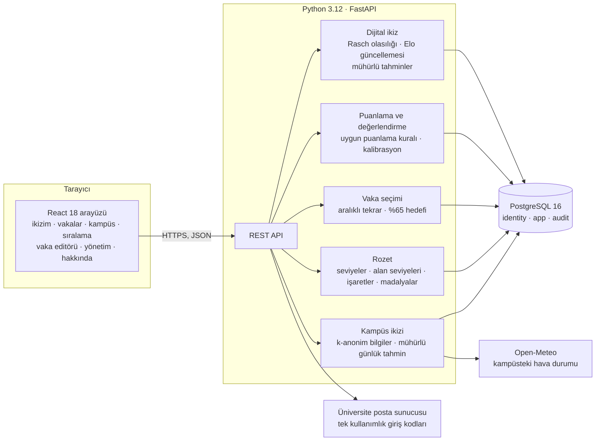

Sunucu, PostgreSQL 16 ile psycopg 3 üzerinden çalışan, Python 3.12 ile yazılmış bir FastAPI uygulamasıdır. Veritabanı kimlik bilgilerini, platformun verilerini ve denetim kayıtlarını ayrı şemalarda tutar. Arayüz, esbuild ile tek bir pakete derlenen bir React 18 uygulamasıdır. Platform konteynerlerde çalışmaktadır. Her değişiklik, gerçek bir tarayıcıda yürütülen uçtan uca testler dâhil 3.000'den fazla denetimden oluşan otomatik bir test paketiyle sınanır.

## Bu depo hakkında

Bu depo, platformun kaynak kodunu görünürlük sağlamak ve yazarlığının kaydını tutmak amacıyla yayımlamaktadır. Depoda sunucu (`server/`), arayüz (`ui/`), arayüz çevirileri (`i18n/`) ve derleme betiği (`build.mjs`) yer alır. Vaka bankası, veritabanı şeması ve geçişleri, kurulum yapılandırması, işletim belgeleri, test paketi, iç araçlar, sentetik kullanıcı üreticisi ve görsel varlıklar depoda yer almaz. Bu nedenle platform bu depodan çalıştırılamaz. Platformu herhangi bir biçimde çalıştırmak yazılı izne bağlıdır (bkz. [Lisans](#lisans)).

## Platformun geliştirilme süreci

Platform, insan ile yapay zekânın işbirliğiyle geliştirilmiştir. Platformun temel çıkış noktası insan entelektüel birikimi ve uzmanlığıdır. Eğitsel tasarımı, yedi alanlı çerçeveyi, ölçme modelini ve mahremiyetle ilgili her kararı geliştiriciler belirlemiş, çalışmanın her aşamasını yönlendirmiş ve denetlemiştir. Kod, vaka metinleri ve görseller geliştiricilerin yönlendirmesiyle yapay zekâ araçlarının yardımıyla üretilmiş, geliştiriciler tarafından gözden geçirilmiş ve sınanmıştır. Rozet amblemleri, avatarlar ve vaka görselleri gibi görseller üretken görsel modellerle hazırlanmış, bir bölümü de kodla çizilmiştir. Nihai hâl, ancak geliştiricilerin incelemesi ve onayından sonra sunulmaktadır. Platformun kendisi üretken yapay zekâ içermez.

## Lisans

Bu depo kaynağı görülebilir bir depodur, açık kaynak değildir. Kod görüntülenebilir, okunabilir ve atıf yapılabilir. Buna karşılık platformu kurmak, çalıştırmak, barındırmak, kopyalamak, değiştirmek ya da dağıtmak, içeriğini başka yerde kullanmak ve yapay zekâ modellerini eğitmek için kullanmak hak sahiplerinin önceden verdiği yazılı izne bağlıdır. Koşulların tamamı, İngilizce ve Türkçe olarak [LICENSE](LICENSE) dosyasındadır. Talepler Prof. Dr. Utku Köse'ye (utkukose@sdu.edu.tr) iletilebilir.

Telif Hakkı © 2026 Utku Köse ve Enes Şenol. Tüm hakları saklıdır.

## Atıf

Platformdan söz ederken aşağıdaki biçimde atıf yapılmasını rica ederiz. Makine tarafından okunabilir atıf bilgisi `CITATION.cff` dosyasındadır. Platformla ilgili bir makale yayımlandığında bu bölüm güncellenecektir. BibTeX kaydı için İngilizce bölümdeki [Citation](#citation) başlığına bakılabilir.

## Kaynakça

Kaynakların tam listesi İngilizce bölümdeki [References](#references) başlığındadır. Metindeki köşeli parantez içindeki numaralar bu listeye karşılık gelir.

## Teşekkür

Platform, Süleyman Demirel Üniversitesi Yapay Zekâ Uygulama ve Araştırma Merkezi (YAZEM) için geliştirilmiştir. Geliştiriciler, YAZEM'in kampüste yapay zekâ okuryazarlığına yönelik çalışmalarına verdiği destek için Süleyman Demirel Üniversitesi'ne teşekkür eder.

---

<div align="center">

**Prof. Dr. Utku Köse · Enes Şenol**<br>
AI Application and Research Center (YAZEM) · Süleyman Demirel University · Isparta, Türkiye<br>
[utkukose.com](https://www.utkukose.com) · [ORCID 0000-0002-9652-6415](https://orcid.org/0000-0002-9652-6415) · [github.com/utkukose](https://github.com/utkukose)

<sub>Copyright © 2026 Utku Köse and Enes Şenol. All rights reserved. Source-available, view only.</sub>

</div>
